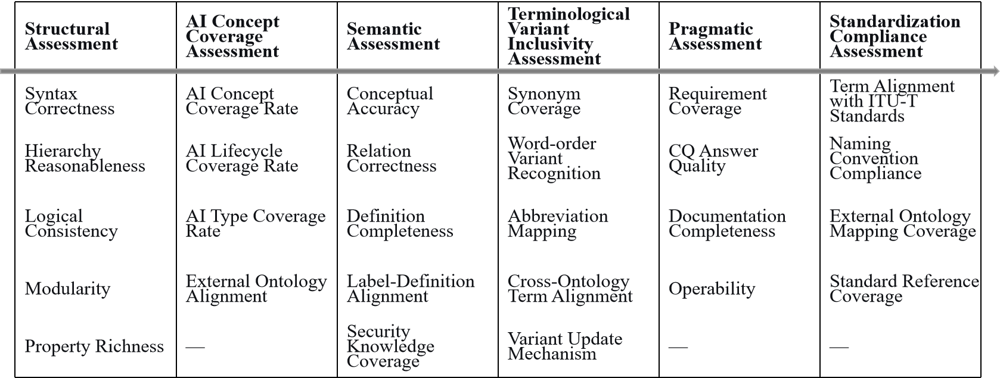

Overall framework structure
---------------------------

The quality assessment framework is designed to assess AI security and trustworthiness ontologies against the requirements specified in clause 7. It comprises six assessment dimensions: Structural Assessment, AI Concept Coverage Assessment, Semantic Assessment, Terminological Variant Inclusivity Assessment, Pragmatic Assessment, and Standardization Compliance Assessment. Dimensions 2 and 4 are distinctive to this framework, addressing the unique characteristics of AI security and trustworthiness ontologies. Figure 1 shows the structure of the framework.

    Figure 1 – Diagram of a quality assessment framework for AI security and trustworthiness ontology
